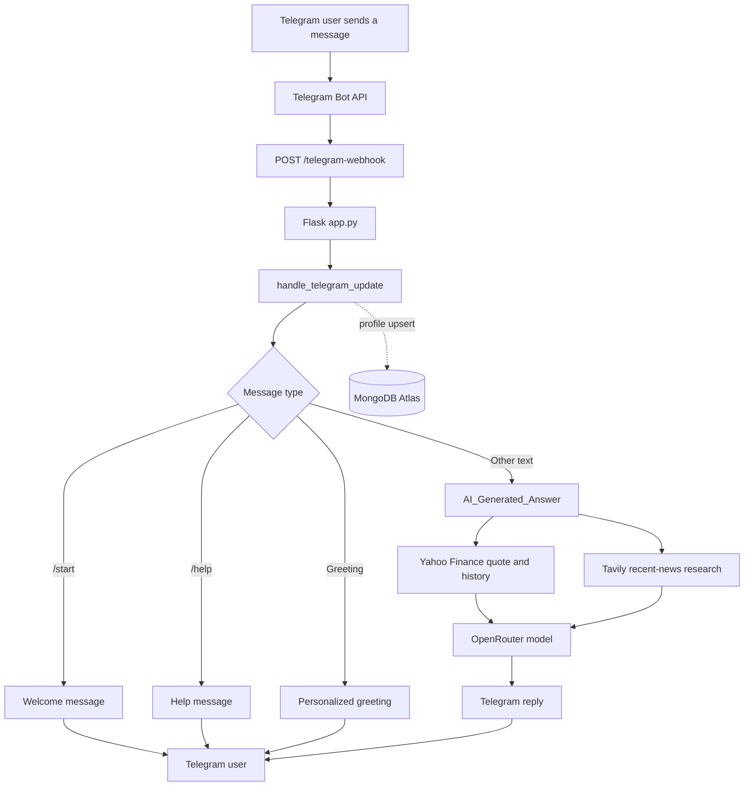
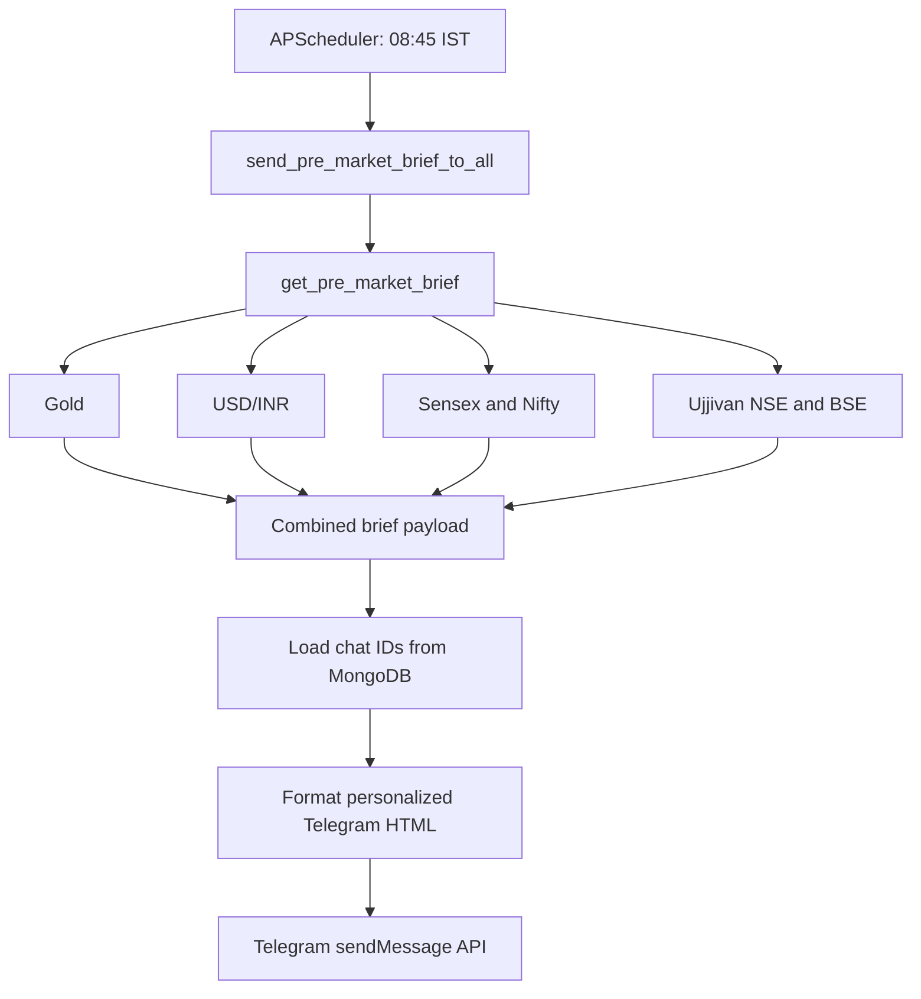

::: {align="center"}
# USPARK Market Updates

### AI-powered Indian market intelligence and automated Telegram briefings

[](https://www.python.org/)
[](https://flask.palletsprojects.com/)
[](https://www.mongodb.com/atlas)
[](https://core.telegram.org/bots/api)
[](https://openrouter.ai/)
[](https://github.com/ranaroussi/yfinance)

**A single Telegram-based market companion for Indian indices, Ujjivan
Small Finance Bank, precious metals, currency data and evidence-led
market explanations.**
:::

------------------------------------------------------------------------

## Contents

-   [Project overview](#-project-overview)
-   [What the platform does](#-what-the-platform-does)
-   [Architecture](#-architecture)
-   [Daily market brief pipeline](#-daily-market-brief-pipeline)
-   [Supported instruments and data
    sources](#-supported-instruments-and-data-sources)
-   [AI research and reasoning
    engine](#-ai-research-and-reasoning-engine)
-   [Telegram bot experience](#-telegram-bot-experience)
-   [Database design](#-database-design)
-   [Repository structure](#-repository-structure)
-   [Technology stack](#-technology-stack)
-   [Configuration](#-configuration)
-   [Local setup](#-local-setup)
-   [Run the application](#-run-the-application)
-   [Deployment](#-deployment)
-   [HTTP endpoints](#-http-endpoints)
-   [Data calculations](#-data-calculations)
-   [Reliability, limitations and implementation
    notes](#-reliability-limitations-and-implementation-notes)
-   [Security notes](#-security-notes)
-   [Useful links](#-useful-links)
-   [License and disclaimer](#-license-and-disclaimer)

------------------------------------------------------------------------

## 📌 Project overview

**USPARK Market Updates** is a Python-based financial information
platform delivered through a Telegram bot. It combines market-data
collection, a scheduled morning market summary, user registration,
persistent chat records and an AI-assisted research workflow.

The system has two principal user-facing workflows:

1.  **On-demand conversation:** a Telegram user sends a question. The
    webhook passes the update to the bot handler, which routes greetings
    and commands directly and sends other text questions to the AI
    research engine.
2.  **Scheduled market briefing:** APScheduler runs the morning job at
    **08:45 Asia/Kolkata**. The application fetches the configured
    market instruments, assembles a pre-market data object, formats a
    personalized Telegram message and sends it to the chat IDs stored in
    MongoDB.

The project is designed around accessible financial information and
explanatory market research. It is not an order-execution,
portfolio-management or investment-advisory system.

## ✨ What the platform does

  -----------------------------------------------------------------------
  Capability                          What is implemented
  ----------------------------------- -----------------------------------
  NSE Nifty 50                        Latest available 5-minute candle,
                                      daily comparison, session high/low
                                      and timestamp

  BSE Sensex                          Latest available 5-minute candle,
                                      daily comparison, session high/low
                                      and timestamp

  Ujjivan SFB --- NSE                 Share-price snapshot and daily
                                      change

  Ujjivan SFB --- BSE                 Separate BSE listing snapshot and
                                      daily change

  Gold                                COMEX gold futures converted from
                                      USD/troy ounce to INR/gram and
                                      INR/10g, with configured duty and
                                      IGST estimates

  Silver                              COMEX silver futures snapshot in
                                      USD/troy ounce

  USD/INR                             Currency-rate snapshot and daily
                                      comparison

  AI market Q&A                       OpenRouter-hosted model responses
                                      enriched with Yahoo Finance quote
                                      context and Tavily news research

  Telegram onboarding                 `/start`, `/help`, personalized
                                      greetings and user profile
                                      persistence

  Morning broadcast                   Personalized daily brief sent to
                                      stored Telegram chats

  Service health                      Flask root status and `/health`
                                      endpoint
  -----------------------------------------------------------------------

> **Scope detail:** Silver has its own data module and is recognized by
> the AI research engine. It is not currently included in
> `Pre_Market_Brief.py` or the scheduled morning Telegram post. The
> morning brief currently contains Gold, USD/INR, Sensex, Nifty 50 and
> Ujjivan SFB on NSE and BSE.

## 🧭 Architecture


The architecture separates the application entry point, Telegram update
handling, AI research, market-data modules and persistent user storage.

### Main components

  -----------------------------------------------------------------------
  Component                           Responsibility
  ----------------------------------- -----------------------------------
  `app.py`                            Flask application, Telegram webhook
                                      registration, webhook endpoint and
                                      APScheduler

  `telegram.py`                       Telegram message sending, update
                                      routing, greetings, user upsert, AI
                                      replies and morning broadcast

  `Openroute.py`                      Market-question interpretation,
                                      Yahoo quote retrieval, Tavily
                                      research and OpenRouter model call

  `Pre_Market_Brief.py`               Calls the individual data modules
                                      and creates the combined brief
                                      payload

  `MongoDB.py`                        Connects to MongoDB Atlas, creates
                                      the unique user index and returns
                                      saved chat IDs

  Instrument modules                  Fetch and normalize market data for
                                      each supported symbol
  -----------------------------------------------------------------------

### Interactive message flow



### Scheduled broadcast flow




## 📊 Supported instruments and data sources

The individual market modules use `yfinance` and Yahoo Finance ticker
identifiers.

  ----------------------------------------------------------------------------
  Instrument        Yahoo Finance     Module                 Returned unit
                    symbol                                   
  ----------------- ----------------- ---------------------- -----------------
  BSE Sensex        `^BSESN`          `BSE_Sensex.py`        Index points

  NSE Nifty 50      `^NSEI`           `NSE_Nifty_50.py`      Index points

  Ujjivan Small     `UJJIVANSFB.NS`   `Ujjivan_SFB_NSE.py`   INR/share
  Finance Bank ---                                           
  NSE                                                        

  Ujjivan Small     `UJJIVANSFB.BO`   `Ujjivan_SFB_BSE.py`   INR/share
  Finance Bank ---                                           
  BSE                                                        

  Gold futures      `GC=F`            `Gold_Price.py`        USD/troy ounce,
                                                             plus converted
                                                             INR values

  Silver futures    `SI=F`            `Silver_Price.py`      USD/troy ounce

  USD/INR           `USDINR=X`        `USD_INR_rate.py`      INR per USD
  ----------------------------------------------------------------------------

Most instrument functions request: - Up to five days of 5-minute
history. - Up to ten days of daily history. - The latest available
intraday candle close. - A previous daily close for change
calculations. - Intraday high and low for the date of the latest
candle. - Market-data and fetch timestamps in the returned payload.

The data functions return dictionaries with an `ok` flag. A successful
result contains normalized values; a failed request returns `ok: False`
and an error field. The code does not establish a guaranteed real-time
exchange feed or a service-level freshness guarantee.

## 🧠 AI research and reasoning engine

The AI workflow is implemented in `Openroute.py` and exposed to the
Telegram handler through `AI_Generated_Answer(prompt)`.

### Research sequence

1.  **Intent and instrument detection:** the prompt is checked for
    supported instruments and market-impact language.
2.  **Ticker resolution:** the code maps the detected instrument to a
    Yahoo Finance symbol. Ujjivan defaults to NSE unless BSE/Bombay is
    explicitly mentioned.
3.  **Quote context:** Yahoo Finance history is used to prefer an
    intraday candle during the configured Indian equity-market window;
    otherwise the latest available daily close is used, subject to the
    code's freshness checks.
4.  **News research:** `_tavily_market_research()` searches for recent
    company, Indian-market and global-market events. The configured
    research window is the latest seven days.
5.  **Model generation:** the combined research context and user
    question are sent to the configured OpenRouter chat-completions
    endpoint. The default model setting is `google/gemini-2.5-flash`.
6.  **Intent-aware validation:** market status and direction are checked
    against the retrieved quote context so a false premise (for example,
    asking why an instrument fell when the latest completed session was
    higher) can be corrected.
7.  **Telegram delivery:** the wrapper returns a safe text response to
    `telegram.py`.

### Research principles encoded in the prompt

-   Prefer official company announcements, exchange filings,
    central-bank and government announcements, official economic
    releases and reputable financial reporting.
-   Distinguish confirmed triggers from possible factors and general
    background.
-   Do not treat price movement, candles, volume or technical indicators
    as the underlying cause of a market move.
-   Do not invent institutional flows, policy decisions,
    company-specific pressure or investor sentiment.
-   Correct a false assumption about market direction before explaining
    a move.
-   Use concise, simple English and avoid presenting unverified causes
    as facts.

### AI provider configuration

-   **Model gateway:** OpenRouter.
-   **Default model:** `google/gemini-2.5-flash` (overridable with
    `OPENROUTER_MODEL`).
-   **News search:** Tavily Search API.
-   **Quote and history context:** Yahoo Finance through `yfinance`.
-   **Key fallback:** up to three OpenRouter API keys are read in
    sequence.

The code also contains a Yahoo Finance news helper,
`_yahoo_news_for_ticker()`. The active `yahoo_research()` path appends
the Tavily research result; the Yahoo news helper is not called by that
path in the supplied implementation.

## 🤖 Telegram bot experience

### Supported commands and message handling

  -----------------------------------------------------------------------
  Input                               Bot behaviour
  ----------------------------------- -----------------------------------
  `/start`                            Saves/updates the user and sends a
                                      personalized welcome post

  `/help`                             Sends short usage instructions

  `Hi`, `Hello`, `Good morning`, etc. Sends a time-based personalized
                                      greeting

  Any other text                      Sends a processing notice, obtains
                                      an AI answer and replies in the
                                      same chat
  -----------------------------------------------------------------------

The handler ignores updates without a usable chat ID, sender ID or text,
and ignores messages sent by bots. Both normal messages and edited
messages are considered.

### Morning market post

The broadcast formatter currently creates a personalized post with: -
Gold price per 10 grams after the configured import-duty calculation,
plus its INR change and percentage. - USD/INR rate and percentage
change. - BSE Sensex and NSE Nifty 50 levels and changes. - Ujjivan SFB
NSE and BSE prices and percentage changes. - Generation timestamp in IST
and a market-data delay/indicative-data note.

The Gold module also calculates a value after IGST, but the current
Telegram formatter displays `price_after_import_duty_per_10g`, not
`price_after_duty_and_igst_per_10g`.

## 🗄️ Database design

The project uses MongoDB Atlas.

-   **Database:** `uspark_market_updates`
-   **Collection:** `users`
-   **Unique index:** `user_id` (Telegram sender/user ID)
-   **Read operation:** `get_all_chat_ids()` returns records with a
    non-null `chat_id`.
-   **Write operation:** `save_or_update_user()` uses an upsert keyed by
    `user_id`.

User records are updated with fields including: - `user_id` -
`chat_id` - `username` - `first_name` - `last_name` - `language_code` -
`is_bot` - `chat_type` - `updated_at` - `first_start_at` (on
insertion) - `last_start_at` and `start_count` (when `/start` is used)

The scheduled broadcaster looks up a user record for each chat ID to
personalize the message.

## 📁 Repository structure

The uploaded files are individual modules. Their imports show that the
intended runtime layout places the market modules and database module
inside a Python package named `Functions`, while `app.py` and
`telegram.py` are at the project root.

Use this layout when assembling the project:

``` text
uspark-market-updates/
│
├── app.py
├── telegram.py
├── requirements.txt
├── .env                    # Create locally; never commit
├── .gitignore
│
├── Functions/
│   ├── __init__.py
│   ├── MongoDB.py
│   ├── Openroute.py
│   ├── Pre_Market_Brief.py
│   ├── BSE_Sensex.py
│   ├── NSE_Nifty_50.py
│   ├── Gold_Price.py
│   ├── Silver_Price.py
│   ├── USD_INR_rate.py
│   ├── Ujjivan_SFB_NSE.py
│   └── Ujjivan_SFB_BSE.py
│
└── docs/
    └── images/
        ├── architecture.png
        └── daily-brief-pipeline.png
```

### Uploaded-file to runtime filename mapping

  Uploaded file              Runtime destination
  -------------------------- ---------------------------------
  `app(1).py`                `app.py`
  `telegram(1).py`           `telegram.py`
  `MongoDB.py`               `Functions/MongoDB.py`
  `Openroute(4).py`          `Functions/Openroute.py`
  `Pre_Market_Brief(1).py`   `Functions/Pre_Market_Brief.py`
  `BSE_Sensex(1).py`         `Functions/BSE_Sensex.py`
  `NSE_Nifty_50(1).py`       `Functions/NSE_Nifty_50.py`
  `Gold_Price(1).py`         `Functions/Gold_Price.py`
  `Silver_Price(1).py`       `Functions/Silver_Price.py`
  `USD_INR_rate(1).py`       `Functions/USD_INR_rate.py`
  `Ujjivan_SFB_NSE(1).py`    `Functions/Ujjivan_SFB_NSE.py`
  `Ujjivan_SFB_BSE(1).py`    `Functions/Ujjivan_SFB_BSE.py`
  `requirements.txt`         `requirements.txt`

`Functions/__init__.py` is shown as an empty package marker; it was not
among the uploaded files.

## 🧰 Technology stack

  ------------------------------------------------------------------------------------------------------------
  Technology              Use in this project     Documentation
  ----------------------- ----------------------- ------------------------------------------------------------
  Python                  Application language    [python.org](https://www.python.org/)

  Flask                   Web server and webhook  [Flask docs](https://flask.palletsprojects.com/)
                          routes                  

  Telegram Bot API        Incoming updates and    [Bot API](https://core.telegram.org/bots/api)
                          outgoing messages       

  APScheduler             08:45 IST scheduled job [APScheduler docs](https://apscheduler.readthedocs.io/)

  MongoDB Atlas / PyMongo User and chat           [Atlas](https://www.mongodb.com/atlas) ·
                          persistence             [PyMongo](https://pymongo.readthedocs.io/)

  yfinance                Yahoo Finance market    [GitHub project](https://github.com/ranaroussi/yfinance)
                          history and quote data  

  OpenRouter              LLM API gateway         [API documentation](https://openrouter.ai/docs)

  Gemini model via        Default configured      [Gemini
  OpenRouter              language model          models](https://openrouter.ai/google/gemini-2.5-flash)

  Tavily                  Recent-news research    [Tavily docs](https://docs.tavily.com/)

  python-dotenv           Environment-variable    [python-dotenv](https://pypi.org/project/python-dotenv/)
                          loading                 

  Requests                HTTP requests to        [Requests docs](https://requests.readthedocs.io/)
                          external APIs           

  pytz / zoneinfo         Time-zone handling      [Python
                                                  zoneinfo](https://docs.python.org/3/library/zoneinfo.html)
  ------------------------------------------------------------------------------------------------------------

## ⚙️ Configuration

Create a `.env` file in the project root. The values below are
placeholders; supply your own credentials.

``` dotenv
# Telegram
TELEGRAM_BOT_TOKEN=your_telegram_bot_token
RENDER_EXTERNAL_URL=https://your-service-name.onrender.com

# MongoDB Atlas credentials
MONGO_DB_USERNAME=your_mongodb_username
MONGO_DB_PASSWORD=your_mongodb_password

# OpenRouter (at least one key)
OPENROUTER_API_KEY=your_openrouter_key
OPENROUTER_API_KEY_2=
OPENROUTER_API_KEY_3=
OPENROUTER_MODEL=google/gemini-2.5-flash

# Tavily news research
TAVILY_API_KEY=your_tavily_key

# Present in MongoDB.py, but not used by the current broadcast flow
Status_TELEGRAM_CHAT_ID=
```

### Environment variable reference

  ------------------------------------------------------------------------------------
  Variable                      Required by supplied code? Purpose
  --------------------------- ---------------------------- ---------------------------
  `TELEGRAM_BOT_TOKEN`                                 Yes Telegram Bot API
                                                           authentication

  `RENDER_EXTERNAL_URL`             Required for automatic Public service base URL
                                   webhook registration in 
                                                  `app.py` 

  `MONGO_DB_USERNAME`                                  Yes MongoDB username

  `MONGO_DB_PASSWORD`                                  Yes MongoDB password

  `OPENROUTER_API_KEY`         At least one OpenRouter key OpenRouter authentication
                                is required for AI answers 

  `OPENROUTER_API_KEY_2`                                No Secondary key fallback

  `OPENROUTER_API_KEY_3`                                No Tertiary key fallback

  `OPENROUTER_MODEL`                                    No Model override; defaults to
                                                           `google/gemini-2.5-flash`

  `TAVILY_API_KEY`                 Optional for the app to Recent-news search
                                  start; needed for Tavily 
                                                  research 

  `Status_TELEGRAM_CHAT_ID`                             No Read into a variable in
                                                           `MongoDB.py`; not used by
                                                           the supplied workflow
  ------------------------------------------------------------------------------------

**MongoDB connection note:** the supplied `MongoDB.py` constructs its
Atlas URI using a cluster hostname embedded in the source and the
username/password environment variables. The `.env` configuration above
does not currently accept a full MongoDB URI. Confirm that the cluster
hostname is the intended one and that the Atlas network-access and
database-user settings permit the deployed service to connect.

## 🚀 Local setup

### 1. Prepare the project directory

Create the `Functions` directory, add an empty `__init__.py`, and place
the modules according to the repository structure above. Rename the
uploaded files to the runtime names in the mapping table.

### 2. Create a virtual environment

``` bash
python -m venv .venv
```

Activate it:

``` bash
# Windows PowerShell
.venv\Scripts\Activate.ps1

# macOS / Linux
source .venv/bin/activate
```

### 3. Install dependencies

``` bash
python -m pip install --upgrade pip
pip install -r requirements.txt
```

### 4. Configure credentials

Create `.env` in the root directory and fill in the required values. Do
not place real API keys in source code or commit `.env`.

### 5. Check MongoDB Atlas access

Ensure the Atlas database user, password and network access
configuration match the connection settings used by
`Functions/MongoDB.py`.

## ▶️ Run the application

Start the Flask application locally:

``` bash
python app.py
```

The application listens on the `PORT` environment variable, defaulting
to `5000`, and binds to `0.0.0.0`.

For a production WSGI server, the dependency list includes Gunicorn. A
typical command is:

``` bash
gunicorn app:app
```

The supplied application starts APScheduler when `app.py` is imported.
Review the deployment note below before running multiple Gunicorn
workers or multiple service instances.

## ☁️ Deployment

The code includes deployment-oriented behaviour for a public host such
as Render:

1.  Deploy the project with the runtime directory structure shown above.
2.  Configure the environment variables in the hosting dashboard.
3.  Set `RENDER_EXTERNAL_URL` to the public HTTPS service URL.
4.  Ensure the host starts the Flask application using the configured
    `PORT` or a WSGI server.
5.  Confirm the root endpoint reports the service status and that
    `/health` responds successfully.
6.  Confirm Telegram's webhook is registered to
    `https://<your-domain>/telegram-webhook`.
7.  Verify the scheduled job's next run in the root endpoint response
    and inspect application logs after the scheduled time.

Useful hosting documentation: - [Render --- Web
Services](https://render.com/docs/web-services) - [Render ---
Environment
Variables](https://render.com/docs/configure-environment-variables) -
[Render --- Health Checks](https://render.com/docs/health-checks)

No live deployment URL, public source repository URL or Telegram bot
username was present in the uploaded files, so none is invented in this
README.

## 🌐 HTTP endpoints

  -----------------------------------------------------------------------------
  Method            Path                  Purpose           Successful response
  ----------------- --------------------- ----------------- -------------------
  `GET`             `/`                   Application       JSON
                                          status, scheduler 
                                          state and next    
                                          scheduled run     

  `GET`             `/health`             Basic process     `{"status":"ok"}`
                                          health check      

  `POST`            `/telegram-webhook`   Receives Telegram JSON
                                          updates and       
                                          invokes the       
                                          handler           
  -----------------------------------------------------------------------------

### Root endpoint example

``` json
{
  "app": "USPARK Market Updates",
  "status": "running",
  "timezone": "Asia/Kolkata",
  "scheduler_running": true,
  "next_run": "..."
}
```

The `next_run` value is generated at runtime and will vary.

## 🧮 Data calculations

### Market change

For the index, stock and USD/INR modules, the code uses:

\[ `\text{Change}`{=tex} = `\text{Latest Price}`{=tex} -
`\text{Previous Daily Close}`{=tex} \]

\[ `\text{Change \%}`{=tex} =
`\frac{\text{Change}}{\text{Previous Daily Close}}`{=tex}`\times 100`{=tex}
\]

The latest price is generally the close of the latest available 5-minute
candle. The comparison close is selected from daily history using the
latest candle date.

### Gold unit and currency conversion

The Gold module uses:

-   Yahoo Finance symbol: `GC=F` (COMEX gold futures).
-   One troy ounce: `31.1034768` grams.
-   Display basis: 10 grams.
-   Configured import-duty rate: `15%`.
-   Configured IGST rate: `3%`.
-   USD/INR rate fetched from the project's currency module.

\[ `\text{USD per gram}`{=tex} =
`\frac{\text{USD per troy ounce}}{31.1034768}`{=tex} \]

\[ `\text{INR per 10g}`{=tex} =
`\text{USD per gram}`{=tex}`\times 10`{=tex}`\times `{=tex}`\text{USD/INR}`{=tex}
\]

The code then applies its configured estimate:

\[ `\text{After duty}`{=tex} =
`\text{INR per 10g}`{=tex}`\times`{=tex}(1+0.15) \]

\[ `\text{After duty and IGST}`{=tex} =
`\text{After duty}`{=tex}`\times`{=tex}(1+0.03) \]

These are the rates and calculation order hard-coded in the supplied
module; this README does not assert that they represent the current
applicable Indian tax treatment. The output is a modelled estimate based
on global futures and the fetched FX rate, not a local bullion-market
quote.

## ⚠️ Reliability, limitations and implementation notes

These notes describe the supplied source files, not assumptions about a
future deployment.

1.  **Data provider:** market data is retrieved through `yfinance` from
    Yahoo Finance. The code itself warns that market data may be delayed
    or indicative; it is not an exchange-certified real-time feed.
2.  **Silver is not in the morning brief:** `Silver_Price.py` exists,
    but `get_pre_market_brief()` does not call it and
    `format_pre_market_post()` does not display it.
3.  **Gold morning display:** the Gold module calculates both after-duty
    and after-duty-plus-IGST values. The current morning post uses the
    after-duty field only.
4.  **Pre-market job timing:** APScheduler is configured for 08:45 IST
    using a daily cron trigger. The supplied trigger does not specify
    weekdays only.
5.  **Scheduler lifecycle:** the scheduler starts at module import time.
    Multiple Gunicorn workers or multiple deployed instances can each
    start a scheduler and may cause duplicate broadcasts. Use a single
    scheduler-owning process or separate scheduler service for a
    multi-worker deployment.
6.  **Webhook setup:** webhook registration is attempted at application
    import time only when both `TELEGRAM_BOT_TOKEN` and
    `RENDER_EXTERNAL_URL` are present.
7.  **Webhook verification:** the supplied webhook route validates that
    the incoming JSON is a dictionary but does not verify a Telegram
    secret-token header.
8.  **Broadcast errors:** individual send failures are counted, but the
    current `send_pre_market_brief_to_all()` function does not return or
    persist the sent/failed counts.
9.  **Startup dependency:** `MongoDB.py` connects to MongoDB and creates
    an index during module import. Missing credentials or an unavailable
    database can prevent application startup.
10. **Dependency list:** `requirements.txt` contains packages not
    referenced by the supplied runtime code (including
    `google-generativeai`, `tweepy`, `praw`, `textblob`, `razorpay`,
    `ta`, `flask-cors` and `user-agents`). They are retained here as
    supplied; this README does not claim they are all required by the
    shown workflows.
11. **No trading functionality:** there is no order placement, broker
    integration, portfolio ledger or automated trading logic in the
    supplied files.
12. **No chart/image delivery in bot:** the current Telegram sender uses
    `sendMessage`; the supplied workflow does not send market charts or
    image attachments to Telegram.

## 🔐 Security notes

-   Keep `.env` out of version control.
-   Rotate any credential that has ever been committed or shared
    publicly.
-   Restrict MongoDB Atlas network access and database permissions to
    the minimum required.
-   Avoid logging complete Telegram update payloads in production; the
    current webhook prints the received update.
-   Add Telegram webhook secret-token validation before exposing the
    webhook publicly.
-   Consider moving the MongoDB URI/cluster hostname into a dedicated
    environment variable rather than embedding it in source.
-   Avoid running duplicate schedulers across multiple workers or
    instances.
-   Review provider terms, rate limits, data freshness and licensing
    before using the platform commercially.

Suggested `.gitignore`:

``` gitignore
.env
.venv/
__pycache__/
*.py[cod]
.pytest_cache/
.mypy_cache/
.DS_Store
```

## 🔗 Useful links

### Project integrations

-   [Telegram Bot API](https://core.telegram.org/bots/api)
-   [Telegram BotFather](https://t.me/BotFather)
-   [OpenRouter](https://openrouter.ai/)
-   [OpenRouter API documentation](https://openrouter.ai/docs)
-   [Gemini 2.5 Flash on
    OpenRouter](https://openrouter.ai/google/gemini-2.5-flash)
-   [Tavily](https://tavily.com/)
-   [Tavily API documentation](https://docs.tavily.com/)
-   [Yahoo Finance](https://finance.yahoo.com/)
-   [yfinance Python package](https://github.com/ranaroussi/yfinance)
-   [MongoDB Atlas](https://www.mongodb.com/atlas)
-   [MongoDB Python driver --- PyMongo](https://pymongo.readthedocs.io/)

### Framework and deployment documentation

-   [Python](https://docs.python.org/3/)
-   [Flask](https://flask.palletsprojects.com/)
-   [Requests](https://requests.readthedocs.io/)
-   [APScheduler](https://apscheduler.readthedocs.io/)
-   [python-dotenv](https://pypi.org/project/python-dotenv/)
-   [Gunicorn](https://gunicorn.org/)
-   [Render Web Services](https://render.com/docs/web-services)
-   [Render Environment
    Variables](https://render.com/docs/configure-environment-variables)

### Market references

-   [NSE India](https://www.nseindia.com/)
-   [BSE India](https://www.bseindia.com/)
-   [Ujjivan Small Finance Bank](https://www.ujjivansfb.in/)
-   [Reserve Bank of India](https://www.rbi.org.in/)
-   [SEBI](https://www.sebi.gov.in/)

## 📜 License and disclaimer

No license file was included in the supplied project files. Add an
explicit license before redistributing the code.

This project provides informational market data and AI-generated
explanations for educational and informational use. Market data may be
delayed, incomplete or unavailable. Gold estimates depend on the source
futures price, FX conversion and configured assumptions. AI-generated
explanations can be incorrect or incomplete and should be independently
verified. Nothing in this project constitutes investment advice, a
recommendation to buy or sell, or a guarantee of future performance.

------------------------------------------------------------------------

::: {align="center"}
**USPARK Market Updates**\
*Stay informed. Understand the market.*
:::
